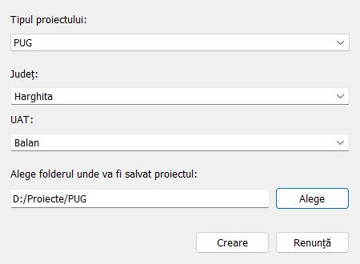
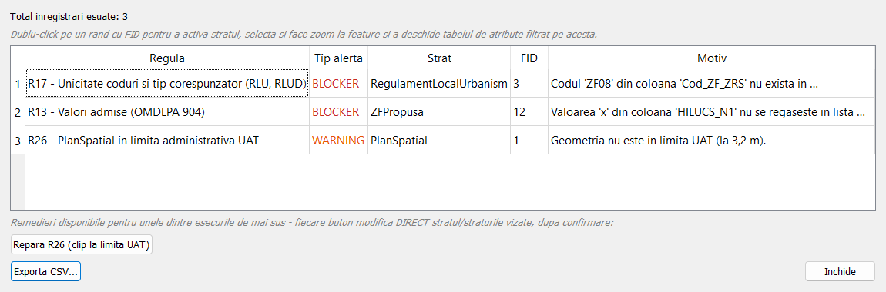
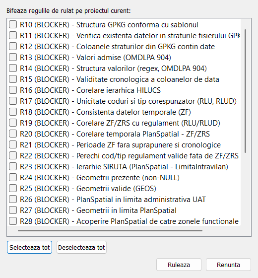
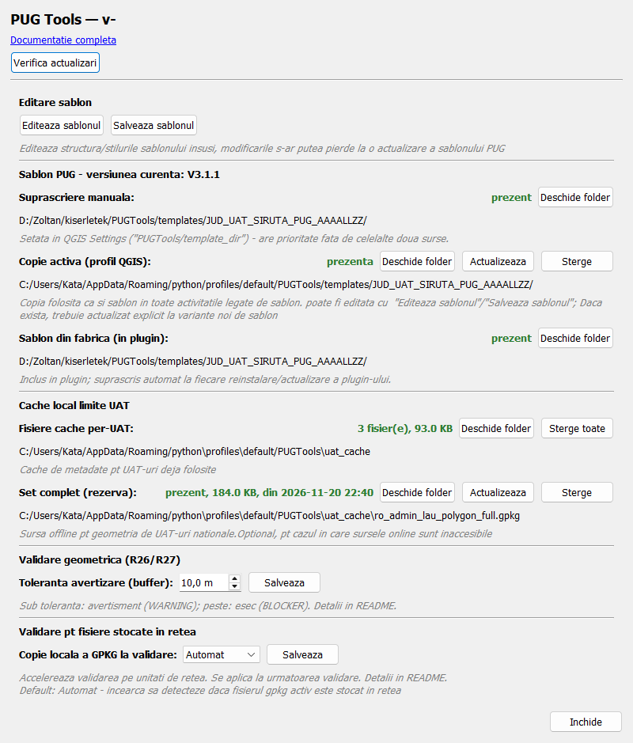

# PUG Tools

Plugin QGIS pentru crearea, administrarea și validarea proiectelor GIS de urbanism
(**PUG / PUZ / PUD / PATJ / PMUD**) conform Ordinului 904/2023. Lucrează cu pachetul
GeoPackage standard (șablonul oficial **3.1.1**) și rulează local regulile de validare publicate de
[MDLPA](https://datelocale.mdlpa.ro/ro/about/info/reguli), ca să corectezi problemele înainte de validarea oficială.

**Șablon îmbunătățit:** proiectele create cu plugin-ul folosesc un șablon GeoPackage pregătit pentru QGIS — cu **simbologia oficială MDLPA**, formulare cu liste de valori, **câmpuri completate automat** etc. [Detalii și cum îl folosești →](#șablonul-pug-în-qgis)

Cerințe: QGIS 3.28 sau mai nou (Qt5 sau Qt6) · Istoricul modificărilor: [CHANGELOG.md](CHANGELOG.md)

## Instalare

1. Descarcă `PUGTools-X.Y.Z.Z.zip` din [Releases](https://github.com/zoltan-k/QGIS-PUG-Tools/releases/latest).
2. În QGIS: **Plugins → Manage and Install Plugins → Install from ZIP**.
3. Actualizările următoare: butonul **Verifică actualizări** din fereastra [Despre](#despre).

## Bara de unelte

Primul grup administrează proiectul, al doilea îl validează, ultimul este „Despre”.
Toate uneltele sunt și în meniul **Plugins → PUG Tools**.

| | Unealta | Pe scurt |
|---|---|---|
|  | [Proiect nou PUG](#proiect-nou-pug) | creează un proiect nou pentru orice UAT |
|  | [Actualizează pachetul](#actualizează-pachetul) | aduce un proiect vechi la șablonul curent |
|  | [Copie de siguranță portabilă](#copie-de-siguranță-portabilă) | un singur .zip cu tot proiectul |
|  | [Consolidează straturile](#consolidează-straturile) | adună straturile din mai multe GPKG într-unul |
|  | [Validare](#validare) | rulează toate regulile |
|  | [Validări selective](#validări-selective) | rulează doar regulile alese |
|  | [Pregătește pentru validare oficială](#pregătește-pentru-validare-oficială) | arhivă datată, gata de încărcat |
|  | [Despre](#despre) | setări, șablon, actualizări |

---

## Proiect nou PUG

Creează un proiect complet pentru orice UAT din România.

1. Apasă butonul. Alege **tipul** (PUG, PUZ, PUD, PATJ, PMUD), **județul** și **UAT-ul**, apoi folderul de destinație și **Creare**.
2. Se creează folderul `<JUD>_<UAT>_<SIRUTA>_<TIP>_AAAALLZZ` cu GeoPackage-ul gol (șablonul curent), subfolderele pentru studii, piese scrise, piese desenate și avize, și proiectul QGIS cu toate straturile.
3. Limita UAT-ului (`~REF_UAT`) se descarcă online la creare (e nevoie de internet; se păstrează apoi în cache).
   Sursa este serviciul WFS al [geo-spatial.org](https://geo-spatial.org/ghiduri/procesari-etl/administrative-boundaries/ro-admin-lau-polygon/) (setul *UAT, România (poligon)*), care publică limitele UAT preluate din geoportalul ANCPI.

Straturile de referință (liste de valori, limita UAT) sunt în grupul **REF**, la sfârșitul listei de straturi.
`AAAALLZZ` din nume se înlocuiește cu data la [pregătirea pentru validare](#pregătește-pentru-validare-oficială).

## Actualizează pachetul

Aduce un proiect creat cu un șablon mai vechi (de ex. 3.0.x sau 3.1.0) la șablonul curent.

1. Deschide proiectul și apasă butonul.
2. Fereastra de confirmare listează **exact ce se va schimba** (tabele de referință noi sau redenumite, stiluri, versiunea pachetului, fișiere lipsă). Poți anula.
3. Înainte de orice modificare se face automat o **copie de rezervă** (`.zip` lângă proiect). Dacă nu se poate crea, nu se modifică nimic.

Datele din straturile cu conținut (PlanSpatial, ZFExistenta etc.) **nu sunt modificate**, cu o singură excepție anunțată în dialog: valorile `Stadiu` fără diacritice se rescriu cu diacritice.
Tipul proiectului (PUG/PUZ/…) se păstrează.

**Poate fi folosită și pentru a reveni la stilurile din șablon:** simbologia, formularele, valorile implicite și acțiunile straturilor se înlocuiesc cu cele salvate în șablonul curent (versiunea lui o vezi în [Despre](#despre)). Dacă ai personalizat stilul unui strat, personalizarea se pierde; confirmarea listează straturile afectate.

Dacă plugin-ul conține un șablon mai nou, unealta întreabă dacă să reîmprospăteze și **copia activă** a șablonului din profilul QGIS — altfel s-ar folosi schema veche.
Butonul apare și în fereastra cu rezultatele validării, când versiunea pachetului diferă de cea a șablonului.

## Copie de siguranță portabilă

Un singur `.zip`, lângă fișierul `.qgz`, care se poate muta pe alt calculator și deschide direct.

- Conține proiectul (cu căi strict relative), tot folderul pachetului `..._AAAALLZZ` și, în `Alte_surse/`, fișierele straturilor din afara pachetului (shapefile, CSV, raster etc.).
- Dacă ai modificări nesalvate, ești întrebat dacă să se salveze întâi.
- Un avertisment te anunță că straturile din memorie se pierd, iar straturile web/PostGIS/virtuale rămân neschimbate.
- Proiectul deschis nu este modificat sau reîncărcat.

## Consolidează straturile

Folosește-l când straturile șablonului din proiect vin din **mai multe fișiere `.gpkg`**.

1. Apasă butonul și alege fișierul-țintă (doar numele standard `<JUD>_<UAT>_<SIRUTA>_<TIP>_<data>.gpkg`; dacă niciunul nu e potrivit, se creează unul nou din șablon).
2. Tabelele din celelalte fișiere le înlocuiesc pe cele cu același nume din țintă.
3. Se salvează proiectul și se face o copie de rezervă; **nu se șterge niciun fișier**. Fișierele nemaifolosite sunt ignorate de copii și de pregătirea pentru validare.

## Validare

Rulează **toate** regulile de validare (R10–R36) pe GeoPackage-ul proiectului curent.

1. Deschide proiectul și apasă butonul.
2. Rezultatele apar într-un tabel: regula, tipul alertei (**BLOCKER** = trebuie corectat, **WARNING** = recomandare), stratul, FID-ul și motivul.
3. **Dublu-click** pe un rând: activează stratul, selectează și face zoom pe obiect și deschide tabelul de atribute filtrat.
4. **Exportă CSV** salvează lista.

Pentru unele reguli apar butoane **Repară …** care corectează direct datele (după confirmare, cu copie de rezervă a GPKG-ului): R18/R20/R21, R19 (RLU / RLUD), R22, R25, R26, R27, R31, R32, R33, R34.
Citește ce face fiecare înainte să o folosești — unele șterg sau decupează obiecte.

R26/R27: geometriile în afara limitei, dar în toleranța din [Despre](#despre) (implicit 10 m), sunt WARNING, nu BLOCKER.

## Validări selective

La fel ca Validarea, dar alegi tu regulile. Util când lucrezi la o anumită problemă sau când vrei să ignori o problemă cunoscută, dar să validezi tot restul.

1. Apasă butonul, bifează regulile dorite (sau **Selectează tot / Deselectează tot**) și **Rulează**.
2. Ultima selecție este reținută pentru data viitoare.

## Pregătește pentru validare oficială

Creează arhiva pe care o încarci la validatorul MDLPA.

1. Rulează întâi validarea locală și, dacă proiectul e mai vechi, [Actualizează pachetul](#actualizează-pachetul).
2. Apasă butonul. Proiectul se salvează și se face o copie a folderului pachetului cu **data de azi** în locul lui `AAAALLZZ` (în numele folderului și al GPKG-ului), arhivată ca `.zip`.
3. Proiectul original se redeschide neschimbat. Fișierele GPKG nefolosite de proiect nu sunt incluse.

## Despre

- **Verifică actualizări** — caută ultima versiune publică pe GitHub; **Descarcă și instalează** verifică SHA-256, salvează versiunea curentă și instalează prin „Install from ZIP”. Nimic nu rulează automat.
- **Editează / Salvează șablonul** — modifici structura și stilurile șablonului (doar pentru utilizatori avansați; modificările se pot pierde la o actualizare de șablon). La salvare, obiectele rămase din greșeală în straturile care trebuie să fie goale pot fi șterse automat.
- **Șablon PUG** — versiunea curentă (V3.1.1) și locul copiilor: *activă* (în profilul QGIS, folosită efectiv) și *din plugin*. Căile apar pe rândul de sub fiecare. **Actualizează** reîncarcă copia activă din plugin, **Șterge** o elimină.
- **Cache limite UAT** — fișierele descărcate la crearea proiectelor; poți șterge sau reîmprospăta.
- **Toleranța de avertizare R26/R27** — distanța până la care o geometrie în afara limitei rămâne WARNING (implicit 10 m).
- **Copia locală a GPKG la validare** — pe unități de rețea validarea poate fi de zeci de ori mai lentă; cu copia locală, GeoPackage-ul se copiază o dată într-un folder temporar (șters apoi) și regulile citesc de acolo. Moduri:
    - `Automat`: detectează dacă proiectul este stocat în rețea și creează o copie locală doar dacă este necesar.
    - `Intotdeauna`: se creează o copie temporară, indiferent unde este stocat proiectul.
    - `Niciodata`: validarea se execută pe fișierul original; poate dura extrem de mult pentru fișiere mari și complexe, accesate prin rețea.

---

## Șablonul PUG în QGIS

Proiectele create (sau actualizate) de plugin folosesc un șablon GeoPackage cu **formulare, valori calculate și stiluri deja configurate**, ca să introduci datele mai repede și cu mai puține greșeli. Ce primești:

- **Structura oficială** (straturi, câmpuri, tipuri) conform șablonului MDLPA 3.1.1.
- **Simbologia oficială** MDLPA, deja aplicată straturilor (vezi mai jos).
- **Liste de valori** în formulare: alegi din liste, nu scrii de mână, iar listele se filtrează în cascadă (de ex. *Tip zonă → Cod zonă*, *HILUCS N1 → N2 → N3*, *Tip rețea → Subtip*).
- **Câmpuri completate automat** (suprafețe, lungimi, date, județ/UAT) și **acțiuni** pentru operații repetitive.
- **Câmpuri obligatorii** marcate ca atare; codurile din regulamente (`Cod_ZF_ZRS`, `Cod_SZF_ZRS_D`) și `ID_RU` nu pot fi duplicate.

### Simbologia oficială

Stilurile urmează simbologia publicată de MDLPA ([Șabloane → Simbologie](https://datelocale.mdlpa.ro/ro/about/info/sabloane); standardul de reprezentare grafică al proiectului SIPOCA 50). Culorile și etichetele din legendă vin direct din ea:

| Strat | Cum este simbolizat |
|---|---|
| `ZFExistenta`, `ZFPropusa` | după `Cod_ZF` (ZF01–ZF18); `ZFExistenta` este etichetat cu `Cod_SZF` |
| `ZonaReglementareSuplimentara` | după `Cod_ZRS` (ZRS01–ZRS33) |
| `CaiComunicatie` | după tip, subtip și stadiu (Existent / Propus) |
| `ReteleTehnicoEdilitare` | după tip, subtip și stadiu; liniile electrice aeriene/subterane sunt etichetate LEA / LES |
| `ReglementariUrbanisticePunct` | după `Tip_RU` |
| `PlanSpatial`, `LimitaIntravilanExistenta`, `LimitaIntravilanPropusa` | culoare unică |
| `RegulamentLocalUrbanism`, `RegulamentLocalUrbanismDetaliat` | tabele, fără geometrie |

### Câmpuri completate automat

Valorile se calculează la crearea obiectului și se **recalculează când îi modifici geometria**:

| Strat | Câmp | Se completează cu |
|---|---|---|
| `PlanSpatial` | `Judet`, `UAT`, `SIRUTA` (doar citire) | din numele fișierului GPKG și din limita UAT (`~REF_UAT`) |
| | `NivelPlan` | *Local* pentru PUG, altfel *infraLocal* |
| | `ArieADM`, `AriePlan`, `ArieINT` | aria UAT-ului, aria planului, suma intravilanului propus (ha) |
| `LimitaIntravilanExistenta`, `LimitaIntravilanPropusa` | `Judet`, `UAT` (doar citire) | ca la `PlanSpatial` |
| | `ArieINT` | aria în hectare |
| `ZFExistenta` | `Arie_ZF` | aria în m² |
| | `Data_exp` | ziua dinaintea datei de aprobare a planului |
| `ZFPropusa`, `ZonaReglementareSuplimentara` | `Arie_ZF` / `Arie_ZRS` | aria în m² |
| | `Data_aprob`, `Data_exp` | datele din `PlanSpatial` (la ZRS, `Data_aprob` este doar citire) |
| `CaiComunicatie`, `ReteleTehnicoEdilitare` | `Lungime` | lungimea în m |

Completează **întâi `PlanSpatial`** (SIRUTA, datele de aprobare/expirare), pentru că de el depind valorile celorlalte straturi.

### Acțiuni pe straturi și obiecte

Acțiunile se pornesc din tabelul de atribute (meniul *Actions*), din *Identify* sau din bara *Actions* a QGIS (acțiunea implicită a stratului, pentru clic pe hartă).

| Strat | Acțiune | Ce face |
|---|---|---|
| `PlanSpatial` | **Preluare poligon UAT** (implicită) | înlocuiește geometria cu limita UAT din `~REF_UAT`; pentru alt tip decât PUG cere confirmare, fiindcă planul poate să nu acopere tot UAT-ul |
| | **Arie limita administrativă** / **Suma arie intravilan propus** | completează `ArieADM` / `ArieINT` |
| | **Reset date** | copiază `Data_aprob`/`Data_exp` ale planului în **toate** obiectele din `ZFPropusa`, `ZonaReglementareSuplimentara` și (`Data_exp`) `ZFExistenta` |
| `LimitaIntravilanExistenta`, `LimitaIntravilanPropusa` | **Clip** (doar în modul de editare) | decupează stratul după `PlanSpatial` și recalculează `ArieINT` (la *Propusa* actualizează și `PlanSpatial.ArieINT`) |
| `ZFExistenta`, `ZFPropusa`, `ZonaReglementareSuplimentara`, `CaiComunicatie` | **Clip by PlanSpatial** | decupează obiectele după limita `PlanSpatial` și recalculează suprafața (m²) / lungimea (m) |

Acțiunile **modifică datele direct** (decupează pe loc și salvează stratul); folosește-le după ce ai făcut o [copie de siguranță](#copie-de-siguranță-portabilă).

### Straturile de referință (grupul REF)

Straturile ajutătoare sunt grupate la sfârșitul listei, în grupul **REF**, care este **restrâns și ascuns** implicit (nu încarcă harta):

- `sys_*` — nomenclatoarele oficiale (zone, HILUCS, tipuri de rețele etc.). **Nu le modifica**; sunt înlocuite la actualizarea șablonului.
- `~REF_UAT` — limita UAT-ului ([sursa](#proiect-nou-pug)).
- `~REF_SZF` și `~REF_ZRS_D` — **le completează proiectantul, înainte de a desena zonele**:
  - `~REF_SZF`: codul și denumirea **subzonelor funcționale** (`Cod_SZF`, `Tip_SZF`);
  - `~REF_ZRS_D`: codul și denumirea **zonelor de reglementare suplimentară de detaliu** (`Cod_ZRS_D`, `Tip_ZRS_D`);
  - conținutul depinde de nevoile identificate în teritoriu. Ele alimentează listele din `ZFExistenta`, `ZFPropusa`, `ZonaReglementareSuplimentara` și `RegulamentLocalUrbanismDetaliat`.
- `~vREF_SZF_ZRS_D` — strat virtual, **creat și completat automat** din cele două tabele de mai sus (cod, tip și tipul zonei: *Subzonă funcțională* / *Zonă de reglementare suplimentară de detaliu*). Alimentează listele din `RegulamentLocalUrbanismDetaliat`; nu se editează.

---

## Reguli și șablon

Regulile urmează validatorul oficial ([pagina de reguli MDLPA](https://datelocale.mdlpa.ro/ro/about/info/reguli), pachetul 2026.11.13) și codul sursă deschis [`cod_validare`](https://github.com/DateLocale-MDLPA/cod_validare).
Plugin-ul **nu verifică** regulile despre folderul arhivei (numărul și numele PDF-urilor din `4_Avize_acorduri`).
R35 și R36 sunt verificări suplimentare ale plugin-ului. Detalii tehnice: [CHANGELOG.md](CHANGELOG.md).

Listele de valori din GeoPackage se numesc `sys_*` (până la șablonul 3.1.0: `_*`); plugin-ul le recunoaște pe ambele la proiectele vechi.

## Proiect

Cod sursă și raportare probleme: [github.com/zoltan-k/QGIS-PUG-Tools](https://github.com/zoltan-k/QGIS-PUG-Tools). Plugin-ul nu este (încă) publicat în repository-ul oficial QGIS. `SBOM.cdx.json` listează dependențele și resursele incluse; `dev/` conține unelte de mentenanță și nu face parte din plugin.

## Licență

Copyright (C) 2026 Zoltán Kelemen. PUG Tools este software liber, sub **GNU General Public License v3 sau (la alegere) o versiune ulterioară** (`GPL-3.0-or-later`); vezi [LICENSE](LICENSE). Licența acoperă codul plugin-ului. Șablonul inclus, datele de referință și documentele (tabela SIRUTA, schema, structura șablonului) provin din specificația oficială MDLPA și rămân supuse propriilor condiții.

---

Acest plugin a fost creat cu <a href="https://claude.com/claude-code">Claude Code</a>.

